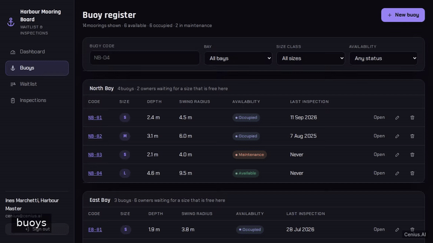
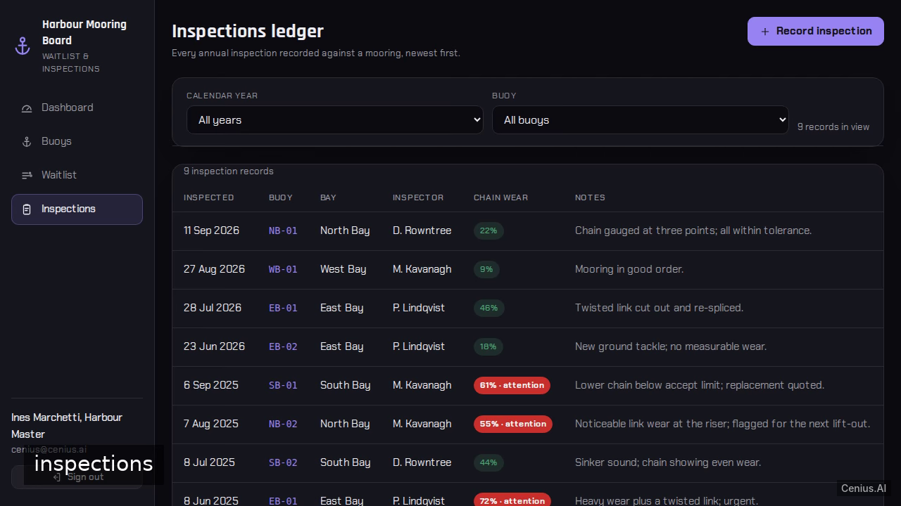
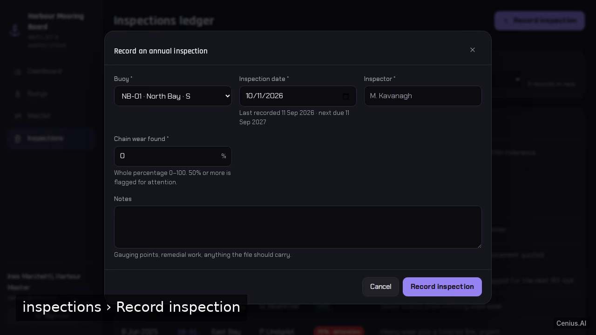

# Harbour Mooring Waitlist Board — Vite admin panel reference implementation

A Vite admin panel, open-source and ready to self-host: that's **Harbour Mooring Waitlist Board**. We will build a two-service web application for harbour staff: a Python FastAPI JSON API backed by SQLite and a React (Vite + TypeScript) single-page app that is compiled with `npm run build` and served as static file…. Harbour Mooring Waitlist Board ships complete — source, design assets, seed data — under the Apache-2.0 license; no cloud account needed. [Remix Harbour Mooring Waitlist Board on cenius.ai](https://cenius.ai/marketplace/p/harbour-mooring-waitlist-board?ref=gh&utm_campaign=harbour-mooring-waitlist-board-vite) for a custom build.


[](LICENSE)  [](https://cenius.ai)

[](https://cenius.ai/marketplace/p/harbour-mooring-waitlist-board?ref=gh&utm_campaign=harbour-mooring-waitlist-board-vite)

> **▶ [Open & edit in cenius.ai](https://cenius.ai/marketplace/p/harbour-mooring-waitlist-board?ref=gh&utm_campaign=harbour-mooring-waitlist-board-vite)** — one click to an editable workspace: describe changes in plain English, get an instant preview, one-click deploy and host. Modifications made on the platform come with full rebrand & relicense rights.

_Local clone? See [Quick start](#quick-start) below. cenius.ai is the zero-setup path._

## Demo



▶ **[Video walkthrough](https://cenius.ai/marketplace/p/harbour-mooring-waitlist-board?ref=gh&utm_campaign=harbour-mooring-waitlist-board-vite)** — see the app in action on the cenius.ai project page · [MP4 file](.github/media/demo.mp4)

## Screenshots

  

## Features

- Staff email/password sign-in
- Bay-by-bay mooring buoy register
- Owner waitlist per mooring size
- Annual inspections recorded with chain wear
- Harbour overview
- Seeded demo harbour

## Architecture

A self-contained Vite project (95 files): top-level directories include `backend/`, `frontend/`, `scripts/`. Run `./install.sh` once to install packages and populate demo data — the app is ready to use immediately after. Step-by-step setup guide: [`INSTALL.md`](INSTALL.md).

## Quick start

```bash
./install.sh   # installs dependencies + seeds demo data
```

See [`INSTALL.md`](INSTALL.md) for full setup and usage instructions.

## Usage guide

Sign in at `/login` with `cenius@cenius.ai` / `cenius` (the credentials are printed
on the card, and there is a one-click demo sign-in button).

The left rail carries four sections — **Dashboard**, **Buoys**, **Waitlist** and
**Inspections** — and your name and sign-out control sit at the foot of it.

---

### Harbour overview (`/dashboard`, and `/` when signed in)

Answers "what needs attention today".

* Four counters, each a link into the matching filtered screen: buoys **available**,
  **occupied**, **in maintenance**, and **owners waiting** (split S / M / L).
* **Inspections overdue** — every buoy with no inspection on record or a last
  inspection more than twelve months old, with its bay, the date of the last
  inspection (or "Never inspected") and how far overdue it is. Clicking a code opens
  that buoy.
* **Longest waiting** — one owner per mooring size with the days waited; clicking one
  opens the waitlist filtered to that size class.
* **Bays** — each bay with its buoy count, linking into the register filtered by bay.
* A legend explaining how status is read (status is always a word as well as a
  colour).

If nothing is overdue the panel says **"All inspections are current"** instead of
showing an empty table.

---

### Buoy register (`/buoys`)

Buoys are grouped under their bay heading, showing code, size class, depth in
metres, swing radius in metres, availability pill and last inspection date.

_Full guide: [`USAGE.md`](USAGE.md)_

## FAQ

### How do I self-host Harbour Mooring Waitlist Board?

Pull the repo, run `./install.sh`, and you are up — the script installs packages and pre-seeds the database. [`INSTALL.md`](INSTALL.md) covers any platform-specific tweaks.

### Can non-developers customise Harbour Mooring Waitlist Board?

The easiest route: [visit the project on cenius.ai](https://cenius.ai/marketplace/p/harbour-mooring-waitlist-board?ref=gh&utm_campaign=harbour-mooring-waitlist-board-vite), tell the platform what to change, and collect the updated build. No source-editing needed.

### Can I build a business on Harbour Mooring Waitlist Board?

Yes — Apache-2.0-licensed, so commercial use, modification, and distribution are all permitted. Read the full terms in [LICENSE](LICENSE).

### How do I customise Harbour Mooring Waitlist Board's branding?

Yes. You can edit the source directly under the MIT license, or [remix it on cenius.ai](https://cenius.ai/marketplace/p/harbour-mooring-waitlist-board?ref=gh&utm_campaign=harbour-mooring-waitlist-board-vite) — the platform route grants full rebrand and relicense rights over your derivative.

### What powers Harbour Mooring Waitlist Board under the hood?

Vite. The full source in this repository is exactly what the app runs. Highlights include seeded demo harbour.

## License & rebranding

Released under the [Apache License 2.0](LICENSE) (© 2026 Cenius AI) — free for personal and commercial use. The Cenius name/logo are trademarks (see NOTICE).

**Need a customized version?** [Remix this app on cenius.ai](https://cenius.ai/marketplace/p/harbour-mooring-waitlist-board?ref=gh&utm_campaign=harbour-mooring-waitlist-board-vite) — modifications made on the platform come with **full rebrand & relicense rights** over your derivative.

## Built with cenius.ai

This entire application — code, design, seeded demo data — was generated on **[cenius.ai](https://cenius.ai)** from a plain-English description.

- 🚀 [Build your own app on cenius.ai](https://cenius.ai)
- 🎛️ [Remix Harbour Mooring Waitlist Board on the marketplace](https://cenius.ai/marketplace/p/harbour-mooring-waitlist-board?ref=gh&utm_campaign=harbour-mooring-waitlist-board-vite) — open it in a workspace, prompt for changes, and ship your own version.

More open-source apps: [the Cenius-ai catalog](https://github.com/Cenius-ai) · [showcase index](https://github.com/Cenius-ai/showcase)
